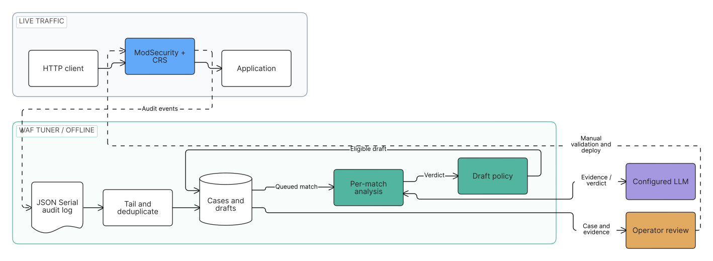

# Architecture

WAF Tuner reads ModSecurity and OWASP CRS audit logs offline. It reviews individual matches and gives operators a queue of scoped exclusion drafts.

<picture>
  <source media="(prefers-color-scheme: dark)" srcset="website/static/diagrams/architecture-dark.svg">
  
</picture>

The [architecture guide](./docs/architecture.mdx) traces the pipeline and shows the evidence sent to the model. The [operator guide](./docs/review.mdx) explains the draft and approval checks.

## Principles

1. **Off-path** — inference never sits in the request path.
2. **No edge writes** — never patches conf or reloads proxies.
3. **System-built exclusions** — LLM classifies; SecLang is built server-side.
4. **Human gated** — review + copy-paste; no auto-mitigation.

## Data stores

| Store | Role |
|-------|------|
| Audit log file | Source of truth for ModSecurity hits |
| SQLite (`waf-tuner.db`) | Parsed audit events, cases, occurrences, revisions, drafts, application profiles |
| `audit_cursor.json` | File identity, read position, and pending data |
| `runtime_config.json` | Operator-set audit log path |

## Lab topology

Compose runs Nginx and ModSecurity in front of DVWA and the Flask Lab Shop. `Host: shop.lab` routes to Flask. The analysis backend reads the audit log from `./lab-data`.

## Out of scope (future)

Managed deploy, engine mode switching, Docker-socket reload.
