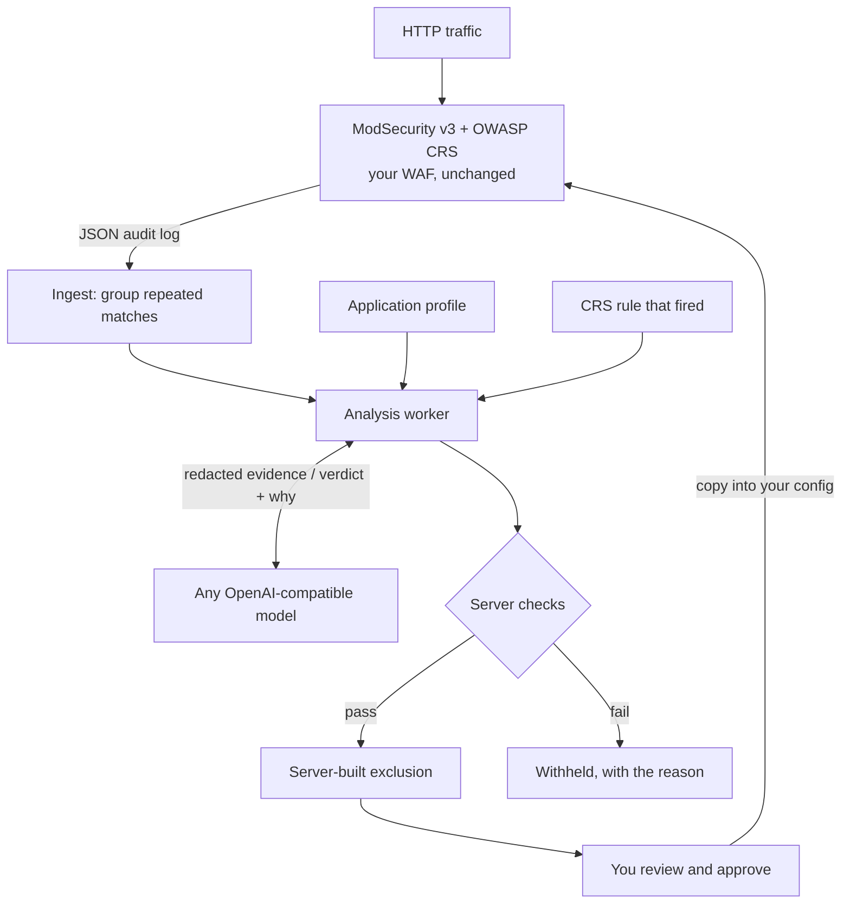
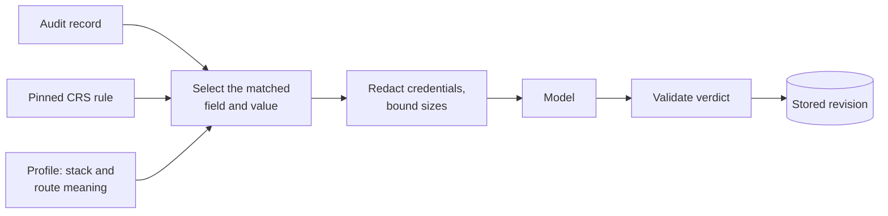

# How it works

WAF Tuner sits beside your WAF, not in front of it. ModSecurity keeps handling live traffic and writes its audit log. WAF Tuner reads that log, asks a model to judge each match, and gives you a reviewed exclusion to deploy yourself.

## From the log to a case

1. **ModSecurity writes an audit event.** WAF Tuner tails the JSON Serial log and keeps a cursor, so restarts and log rotation lose nothing.
2. **Ingest stores the event and groups matches.** Each CRS match becomes a case. A fingerprint over the rule, field and value groups repeated identical matches, so the same false positive is judged once. Anomaly-score rules are kept as context, not judged.
3. **A worker picks up a queued case.** It selects the application profile for the host and route, loads the exact CRS rule that fired, and builds a bounded, redacted copy of the evidence.
4. **The model returns a verdict.** The worker validates the JSON. Invalid output gets one repair call. An `uncertain` verdict can get one stronger reasoning call if you enable escalation.
5. **The server decides whether a rule can be drafted.** See [Review an exclusion](./review.md) for every check.

## What the model receives

The evidence is a JSON message: method and path, the matched field and value, the rule ID, message and operator, sibling rule IDs, and the stack and route facts from the profile. Credential-like names (sessions, tokens, passwords, signatures) are redacted, and long values are cut to fixed limits. If cutting removes the profile, no draft is produced. Check [data handling](./limits.md#model-egress-and-local-storage) before you point WAF Tuner at a hosted model.

The verdict carries `classification`, `confidence`, a one-line `verdict`, and three required explanation fields:

| Field | Answers |
| --- | --- |
| `rule_looks_for` | What the CRS rule is designed to detect |
| `payload_is` | What the matched value actually is |
| `why` | Why they differ (false positive), match (true positive), or what is missing (uncertain) |

It also records `applies_to_stack`, whether the technique would work on your stack. That is recorded only: an attack that could not work on your stack is still an attack.

## Where state lives

| Store | Contents |
| --- | --- |
| ModSecurity audit log | Source transactions and detections |
| SQLite | Events, cases, occurrences, profiles, analysis revisions and drafts |
| Ingest cursor | Audit file identity, read position and any pending data |
| CRS rules directory | The rule text and data files used to interpret matches |
| Profiles directory | One JSON file per application (see [Profiles](./profiles.md)) |
