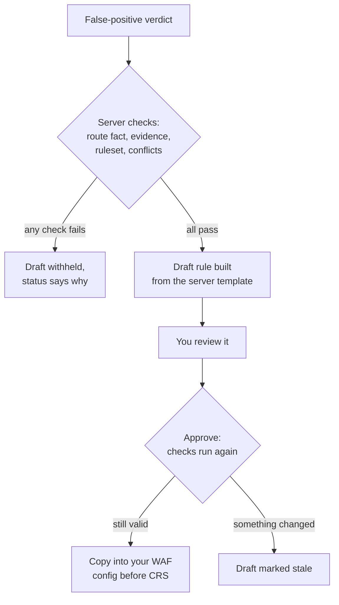

# Review an exclusion

A false-positive verdict describes the observed match. An exclusion affects future requests too, so WAF Tuner applies additional checks before a verdict becomes a draft, and repeats them when you approve.

## Read the case

Suppose a product search contains the words “union select hoodie”. The model can explain that the rule looks for SQL syntax and that the words are part of a search phrase. A profile can add that `GET /search` accepts free-text `q` and that the application binds it as data. Review the actual match, the operator it triggered, and whether your application really handles the field as described.

If that evidence supports the verdict and draft checks pass, the builder can produce a target exclusion for one rule, one field, one host, one HTTP method, and one path. The exclusion covers future values of that field too. Review it against how the application uses the field and any WAF protection you still expect on it.

## Why a draft can be withheld

| Status | What it means |
| --- | --- |
| `not_applicable` | The verdict is true positive or uncertain. |
| `missing_application_context` | The draft requires a route fact and suitable context was unavailable, or the profile was dropped from the provider message. |
| `cannot_build` | The observed scope cannot be represented by the supported rule builder. |
| `missing_crs_rule` | The rule associated with the alert was unavailable in the analysis evidence. |
| `ruleset_uncertain` | The alert may have fired under a different ruleset around a change. |
| `rule_changed_since_alert` | The current rule differs from the one used for the alert. |
| `chained_rule_review` | The detection belongs to a chained rule that needs manual review. |
| `missing_match_evidence` | The value was unavailable, hidden, or truncated. |
| `scope_conflict` | A true-positive verdict overlaps the same observed input or the proposed rule’s scope. |
| `duplicate_scope` | Another active draft already owns the scope. |
| `id_conflict` | The generated rule ID collides with another active draft. |
| `stale_context` | A current ruleset, model configuration, or application profile check failed. |
| `evidence_expired` | The supporting audit evidence aged out before review. |
| `valid` | The draft passed the server checks. It still needs operator review. |

## Approve and apply

1. Open **Exceptions** and inspect the proposed rule, host, method, path, and target.
2. Approve the draft. WAF Tuner repeats its current-context and conflict checks.
3. Copy the rule into your WAF’s operator-managed exclusions include before CRS. Verify your full configuration and test the intended traffic in your environment.
4. Reload the WAF through your normal process and keep a rollback copy.

If a later conflict makes a draft stale, review any corresponding rule you already installed. WAF Tuner tracks the draft in SQLite. Your WAF configuration is managed separately.
