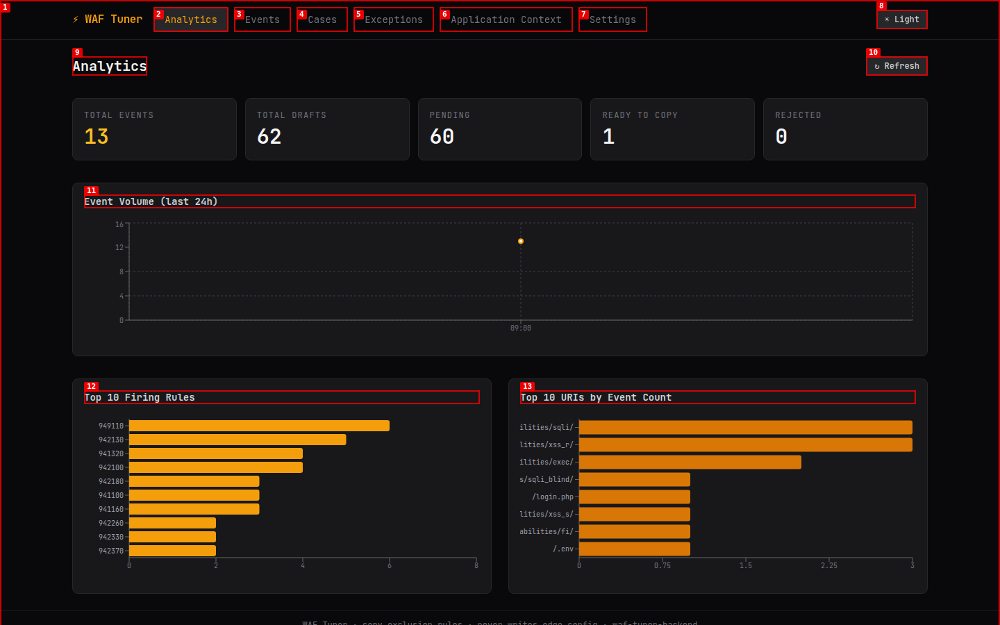
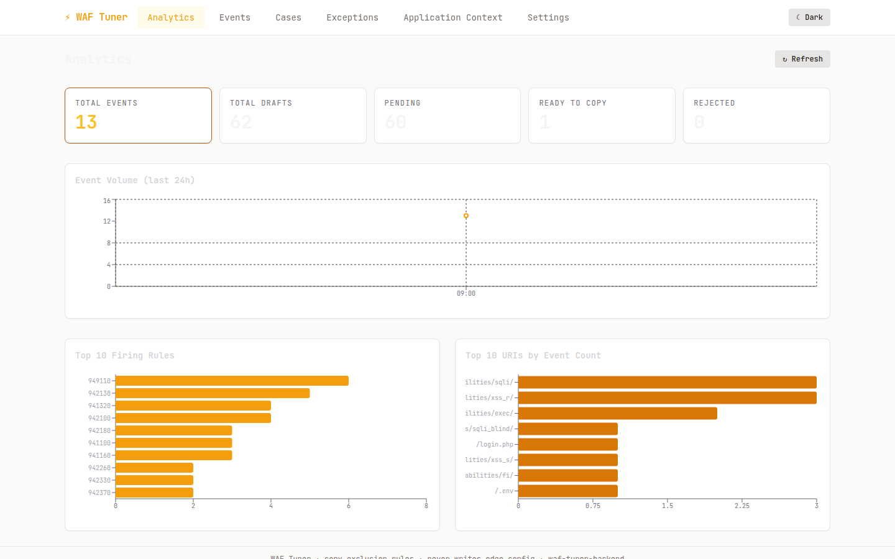
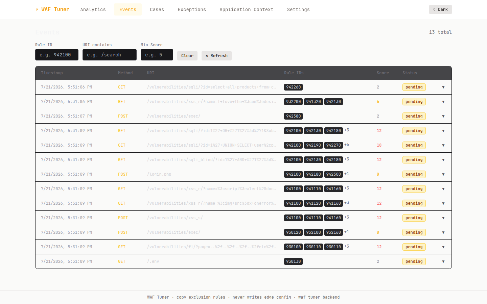
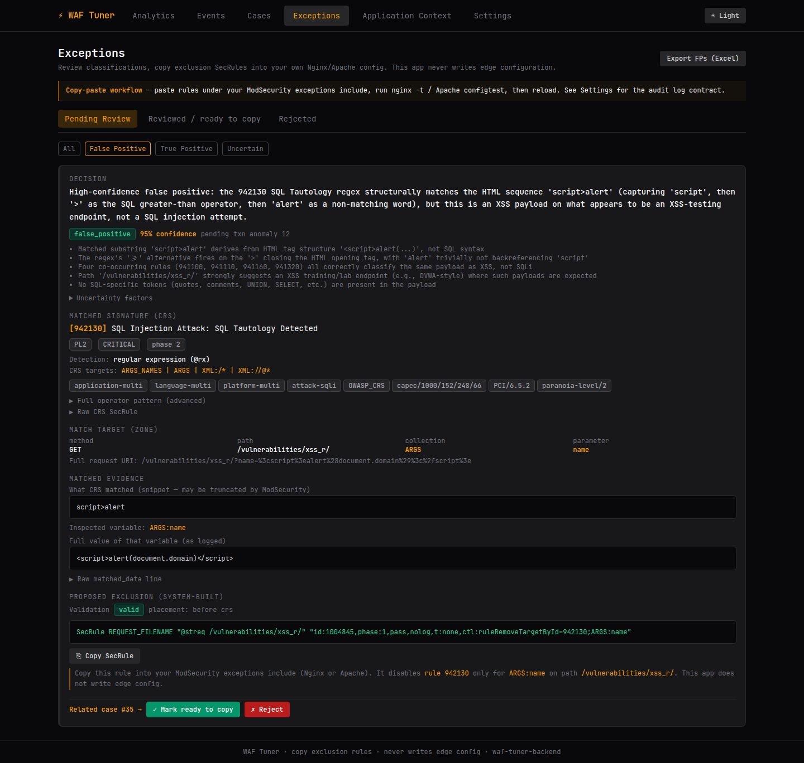
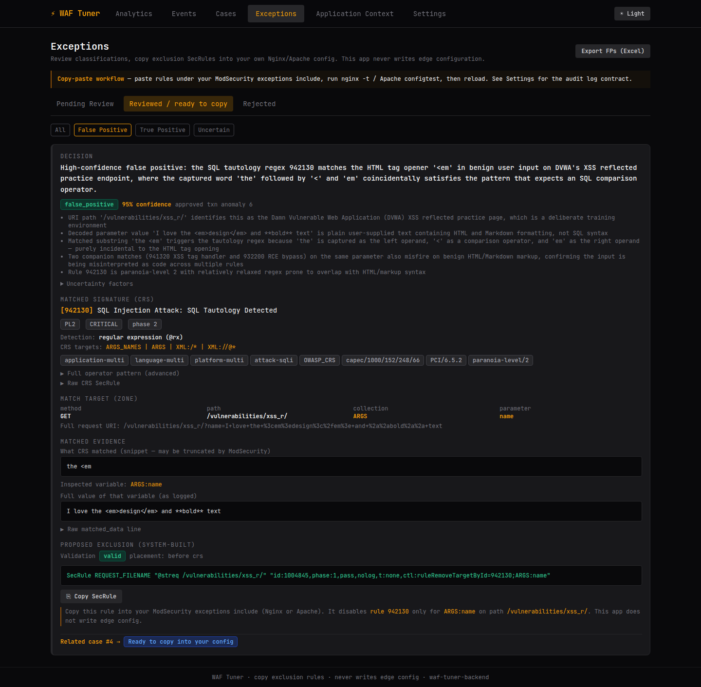
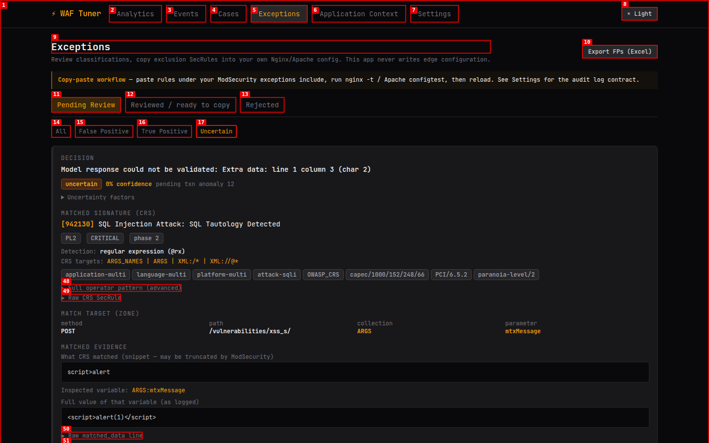
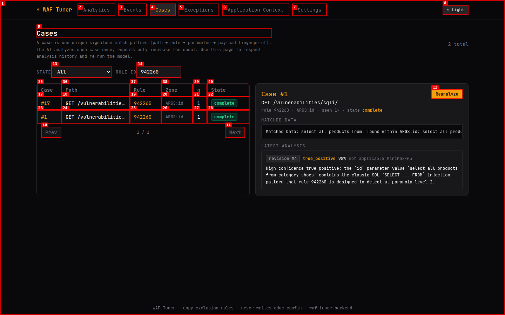
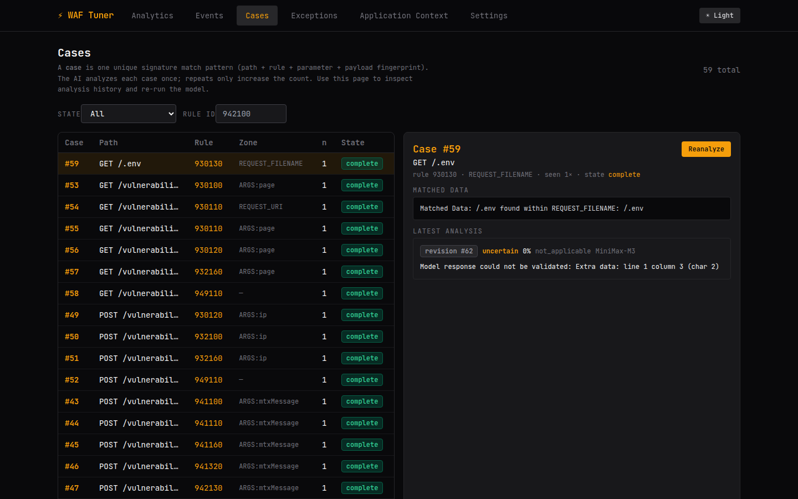
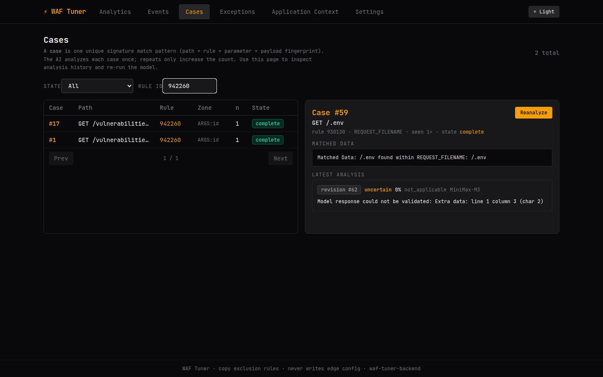
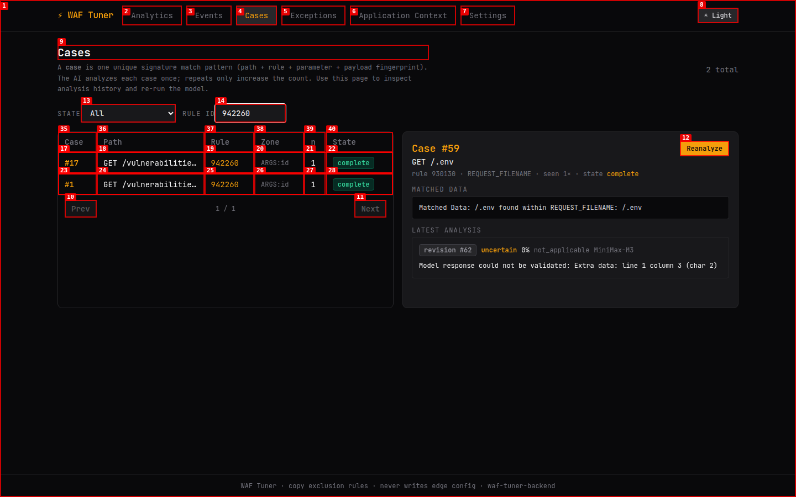

# Dogfood Report: WAF Tuner Portal

| Field | Value |
|-------|-------|
| **Date** | 2026-07-21 |
| **App URL** | http://localhost:3000 |
| **Session** | waf-tuner-portal |
| **Scope** | Laptop viewport, light/dark modes, events, cases, exceptions, AI analysis, logs |

## Summary

| Severity | Count |
|----------|-------|
| Critical | 0 |
| High | 3 |
| Medium | 3 |
| Low | 0 |
| **Total** | **6** |

## Issues

### ISSUE-001: URI chart labels are clipped at laptop width

| Field | Value |
|-------|-------|
| **Severity** | medium |
| **Category** | visual |
| **URL** | http://localhost:3000/ |
| **Repro Video** | N/A |

**Description**

At a 1440×900 viewport, the “Top 10 URIs by Event Count” Y-axis labels begin outside the chart card and lose their leading path segments. The accessible page text contains the complete URIs, but the rendered labels show fragments such as `ilities/sqli/`, which makes the ranking ambiguous.

**Repro Steps**

1. Open Analytics at 1440×900 in dark mode and reload the page.
2. Observe the left edge of the “Top 10 URIs by Event Count” chart.
   

---

### ISSUE-006: Core text becomes nearly invisible in light mode

| Field | Value |
|-------|-------|
| **Severity** | high |
| **Category** | visual / accessibility |
| **URL** | http://localhost:3000/ and http://localhost:3000/events |
| **Repro Video** | N/A |

**Description**

The light theme retains very pale typography on white surfaces in two core views. On Analytics, the page heading, most KPI values, chart titles, axes, and labels have insufficient contrast. On Events, the heading, timestamps, URI text, and secondary row content are similarly difficult to read, while filter controls retain dark backgrounds. Cases and Exceptions are substantially more readable, so the defect appears to be inconsistent use of semantic theme colors rather than a global palette limitation.

**Repro Steps**

1. Set the portal to Light mode at 1440×900.
2. Open Analytics and observe the KPI and chart text.
   
3. Open Events and observe the heading and table metadata.
   

---

### ISSUE-005: The same exclusion scope appears as both approved and pending

| Field | Value |
|-------|-------|
| **Severity** | medium |
| **Category** | functional |
| **URL** | http://localhost:3000/exceptions |
| **Repro Video** | N/A |

**Description**

Pending case #35 and approved case #4 produce the identical exclusion for path `/vulnerabilities/xss_r/`, rule `942130`, and target `ARGS:name`, including the same generated rule ID `1004845`. Reviewing by payload fingerprint allows duplicate scope-level recommendations. Copying both into a configuration would create duplicate SecRule IDs and fail config validation.

**Repro Steps**

1. Open Pending Review → False Positive and inspect case #35.
   
2. Open Reviewed / ready to copy and inspect case #4.
   
3. Observe that both cards contain the same generated SecRule.

---

### ISSUE-004: Ten analyses failed JSON validation and became opaque 0% results

| Field | Value |
|-------|-------|
| **Severity** | high |
| **Category** | functional |
| **URL** | http://localhost:3000/exceptions |
| **Repro Video** | N/A |

**Description**

The Uncertain filter contains 10 pending analyses whose decision is a parser error such as `Extra data: line 1 column 3` or `Expecting property name enclosed in double quotes`. These include clear SQLi, XSS, LFI, and command-injection payloads as well as likely false positives. The operator gets neither a usable classification nor actionable recovery guidance, while backend logs show successful HTTP 200 responses from the model provider.

**Repro Steps**

1. Open Exceptions → Pending Review.
2. Select the Uncertain classification filter.
3. **Observe:** 10 result cards report model-response JSON validation failures at 0% confidence.
   

---

### ISSUE-003: Benign product-search phrase is classified as a 98% true positive

| Field | Value |
|-------|-------|
| **Severity** | high |
| **Category** | functional |
| **URL** | http://localhost:3000/cases/1 |
| **Repro Video** | N/A |

**Description**

The AI labels `select all products from category shoes` as a 98%-confidence SQL-injection true positive solely because it contains `SELECT ... FROM`. This is natural-language search traffic and is the exact false-positive class the product is intended to identify. The neighboring malicious case using `UNION SELECT user,password FROM users--` is correctly classified, so the UI provides a useful direct comparison.

**Repro Steps**

1. Filter Cases for rule `942260`.
2. Select case #1.
3. **Observe:** the matched data is a benign product-search sentence, but Latest Analysis reports `true_positive` at `98%`.
   

---

### ISSUE-002: Filtering cases leaves an unrelated analysis selected

| Field | Value |
|-------|-------|
| **Severity** | medium |
| **Category** | ux |
| **URL** | http://localhost:3000/cases/59 |
| **Repro Video** | Unavailable: local `ffmpeg` execution failed; step screenshots captured |

**Description**

Filtering the case list does not clear or reconcile the selected case. After filtering for rule `942260`, the list contains only cases #17 and #1, while the detail pane still shows case #59 for rule `930130`. This makes the visible AI analysis appear to belong to the filtered results.

**Repro Steps**

1. Open case #59 and confirm its analysis is selected.
   
2. Enter `942260` in the Rule ID filter.
   
3. **Observe:** the list contains only rule 942260, while the right pane remains on rule 930130 / case #59.
   

---

## Coverage and Runtime Observations

- Tested at a 1440×900 laptop viewport in both dark and light modes.
- Covered Analytics, Events (including an expanded event), Cases and analysis history, Exceptions across classifications and review states, Application Context, and Settings/audit-log status.
- Browser console and runtime error collections were empty during the pass.
- The sample contains 13 events, 59 deduplicated cases, and 60 pending exception reviews; only one recommendation is currently ready to copy.
- Backend health and portal API requests were successful. Model transport was mostly HTTP 200, with two deferred attempts for case 47 caused by `APITimeoutError`; processing later continued.
- Nginx loaded ModSecurity 3.0.16 with 930 rules. Its only notable runtime warning was expected TLS stapling noise from the lab certificate.
- The DVWA container reports `unhealthy` even though the public nginx lab endpoint and the rest of the stack are healthy. The health check should be corrected so Compose status remains trustworthy.

## Recommended Changes

1. **Make AI output validity a first-class health metric.** Count valid structured analyses separately from HTTP-successful model calls. Use the provider's structured-output mode where available, validate once, and make one bounded repair/retry attempt before presenting an explicit recoverable failure.
2. **Add a small, versioned AI regression set.** Include the benign `select all products from category shoes` case next to true SQLi, XSS, traversal, and command-injection examples. Gate prompt/model changes on classification and confidence, with application-route context included in the evaluation.
3. **Deduplicate exclusions by effective WAF scope.** Key proposals by path, rule ID, collection, and parameter—not payload fingerprint—and group additional triggering examples beneath the existing proposal. Never emit the same SecRule ID twice.
4. **Fix theme tokens and add contrast checks.** Replace view-specific pale/dark text values with semantic foreground/muted/input tokens. A lightweight screenshot or accessibility check for Analytics and Events in both themes is enough; no new UI framework is needed.
5. **Keep list selection consistent with filters and URLs.** If the selected case is removed by a filter, select the first visible result or clear the detail pane. The highlighted row, URL, and detail heading should always identify the same case.
6. **Tighten the operator workflow.** Collapse exception cards to summaries by default (classification, confidence, path, rule, parameter), open one detail at a time, decode URIs for display while preserving raw values in expanded details, and expose analysis validity/backlog on Analytics.
7. **Fix the chart margin and lab health check.** Reserve enough left margin for the longest URI label (with tooltip fallback), and repair the DVWA health probe. Both should be small, dependency-free changes.

The strongest part of the product is the traceability from raw event to rule match to model rationale to copyable exclusion. The main open-source risk is trust: a tuning tool must be visibly conservative and reproducible, but high-confidence misclassification, parser failures, and duplicate rule generation currently weaken that contract.
